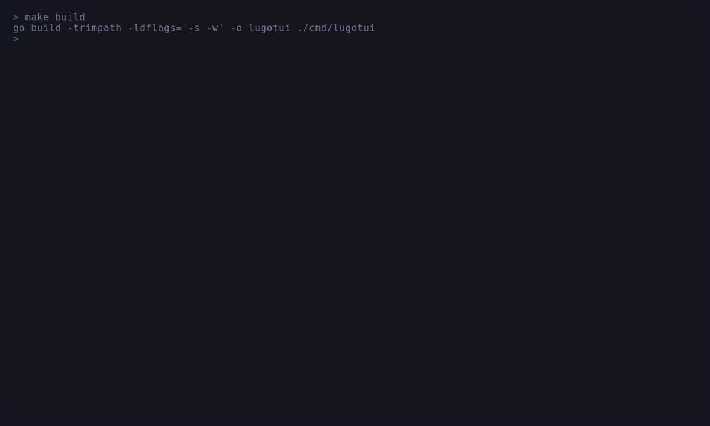

# LugoTUI

[](https://pkg.go.dev/github.com/VintlGvard/LugoTUI/tui)
[](LICENSE)
[](https://github.com/VintlGvard/LugoTUI/releases/latest)

**Declarative, Lua-driven Terminal UI Engine for Go with instant Live Hot-Reload and built-in AI Agent IPC.**

Stop recompiling your Go binary every time you tweak a margin or color. **LugoTUI** separates backend logic (Go) from declarative UI layouts (embedded Lua), with a Flexbox subset and file-backed hot-reload polling every 150ms. Builds support `CGO_ENABLED=0`; reload latency still depends on script work and scheduling.



---

## Why LugoTUI?

* 🔥 **Live Hot-Reload:** Edit `.lua` files; file-backed apps check for changes every 150ms and restore compatible focus, inputs, and state after a successful reload.
* 📦 **Zero CGO, Pure Go:** Powered by `tcell/v2`, `uniseg`, and `GopherLua`. Cross-compiles to a single static binary on Linux, macOS, and Windows.
* 📐 **Flexbox Layout Engine:** Built-in `row`, `column`, `grow`, `shrink`, `gap`, `padding`, `z_index`, and absolute positioning.
* 🧩 **Rich Native Widgets:** Out-of-the-box `table`, `tree`, filterable `list`, `viewport`, `input`, `textarea`, `modal`, `filepicker`, gradients, and 12 `spinner` presets with Vim navigation (`j/k/g/G`) and full mouse support.
* 🤖 **AI Agent-Ready (IPC Socket):** Inspect UI snapshots, trigger actions, and stream events externally via a JSON Lines Unix domain socket.
* 🛡️ **Transactional & Sandboxed:** Lua errors roll back cleanly without crashing the screen. Optional Linux `bubblewrap` + `prlimit` sandbox isolates untrusted UI scripts.
* 🪶 **Event-Driven Rendering:** The animation ticker stops when `NeedsTick()` is false. A blinking input cursor also needs ticks; file-backed apps poll for changes every 150ms.

---

## Performance & Memory Footprint

Tested on **12th Gen Intel(R) Core(TM) i5-12450H, Linux amd64, Go 1.26**:

* **Idle Behavior:** The main event loop waits for events when `NeedsTick()` is false. Timers, animated widgets, and a focused input or textarea with a blinking cursor activate the animation ticker (16ms interval). File-backed apps additionally poll file metadata every 150ms for hot-reload. Idle CPU depends on the active UI and environment; no universal 0.00% guarantee is implied.
* **Sub-millisecond Frame Time:** Pure Flexbox layout calculation completes in **45 µs** (~22,000 passes/sec). State mutations (`ui.set`/`ui.patch`) execute in **162 µs**. Full mutation + cell-diff render pass takes **2.6 ms** (~375 FPS).
* **Minimal RAM Footprint:** Idle process consumes **~14 MB RSS** (`VmRSS: 14,436 kB`) with active GopherLua VM, reactive bindings, and widget tree. Static binary is **5.3 MB** (`CGO_ENABLED=0`, `-s -w`).

| Operation | Time (latency) | Memory (B/op) | Allocs (allocs/op) |
| :--- | :--- | :--- | :--- |
| **Visible Nodes Traversal** | `10.1 µs` | `0 B` | `0 allocs` |
| **Flexbox Layout Pass (120x40)** | `45.3 µs` | `768 B` | `11 allocs` |
| **State Mutation (`ui.set` / `ui.patch`)** | `162.9 µs` | `55.8 KB` | `419 allocs` |
| **Frame Render & Cell Diffing** | `2.34 ms` | `276.0 KB` | `42,319 allocs` |
| **State Mutation + Full Diff Render** | `2.66 ms` | `331.9 KB` | `42,590 allocs` |
| **Cold Start & Lua Tree Build (570 LOC)** | `3.80 ms` | `2.59 MB` | `35,525 allocs` |

> *Reproduce locally: `go test -bench='^Benchmark(InitLoad|LayoutPass|RenderDiffPass|StateMutation|VisibleNodes)$' -benchmem ./...`*

---

## Getting started: choose one path

- **Go library:** embed a Lua UI in your own Go application, with Go callbacks and workers. Follow [Library](#1-go-library).
- **Ready-made CLI:** run Lua without writing Go. Follow [CLI](#2-ready-made-cli).
- **LugoTUI development:** change this repository itself. Follow [Development](#3-developing-lugotui).

### 1. Go library

Requires **Go 1.26.0 or newer** (the module's minimum Go version). Start outside the LugoTUI repository; no clone or `replace` directive is needed:

```sh
mkdir hello-lugotui
cd hello-lugotui
go mod init example.com/hello-lugotui
go get github.com/VintlGvard/LugoTUI/tui@v0.1.1
```

Create `app.lua` in this directory (your declarative UI and state):
```lua
local ui = require('ui')

return {
  api_version = 1,
  view = function()
    return ui.column {
      padding = 1, gap = 1,
      ui.text { text = "Hello from LugoTUI!", height = 1 },
      ui.input { id = "name_in", bind = "name", placeholder = "Type your name...", height = 1 },
      ui.text { id = "greeting", text = "Waiting for input...", height = 1 },
      ui.button { id = "btn", text = "Uppercase & Save", on_click = "save", height = 1 }
    }
  end,
  actions = {
    save = function()
      local name = ui.get("name") or "Stranger"
      ui.set("name", string.upper(name))
      ui.patch("greeting", { text = "Saved: " .. string.upper(name) })
    end
  }
}
```

Create **`main.go`** (your Go host):
```go
package main

import (
	"log"

	"github.com/VintlGvard/LugoTUI/tui"
)

func main() {
	err := tui.RunOptions(tui.Options{
		AppFile: "app.lua",
		Theme:   tui.Theme{Background: "black", FocusForeground: "cyan"},
	})
	if err != nil {
		log.Fatal(err)
	}
}
```

From `hello-lugotui`, containing `go.mod`, `main.go` and `app.lua`, run:

```sh
go run .
```

`AppFile` is relative to the process working directory, not the executable. The **Uppercase & Save** button runs Lua's `save` action; no Go callback is needed. Quit with `Ctrl+Q` or `Ctrl+C`. File edits hot-reload; `F5` reloads manually. For Go events, workers, errors and cancellation, run the [worker example](examples/worker/) or read [Managed Runner Integration](docs/architecture.md#3-managed-runner-integration).

### 2. Ready-made CLI

Download **v0.1.1** from [GitHub Releases](https://github.com/VintlGvard/LugoTUI/releases/latest). Pick your OS (`linux`, `macos`, `windows`) and CPU (`amd64` for x86-64, `arm64` for ARM64, including Apple silicon). Binary availability is not a promise that every terminal/OS combination has been manually tested.

Unix example (Linux x86-64; substitute your downloaded filename):

```sh
mkdir -p lugotui-bin
tar -xzf lugotui_v0.1.1_linux_amd64.tar.gz --strip-components=1 -C lugotui-bin
./lugotui-bin/lugotui --app app.lua
```

Windows PowerShell example:

```powershell
Expand-Archive .\lugotui_v0.1.1_windows_amd64.zip -DestinationPath .\lugotui-bin
.\lugotui-bin\lugotui_v0.1.1_windows_amd64\lugotui.exe --app .\app.lua
```

Use the `app.lua` above. For installation in `PATH`, SHA-256 checks and unsigned macOS limitations, see [CLI installation](docs/install.md). Source installation is an alternative, requiring Go 1.26.0+:

```sh
go install github.com/VintlGvard/LugoTUI/cmd/lugotui@v0.1.1
lugotui --help
lugotui --version
lugotui --app app.lua
lugotui --app app.lua --check
```

`go install` writes to `GOBIN`, or `$(go env GOPATH)/bin` when `GOBIN` is unset; add that directory to `PATH`. An installed CLI runs Lua actions, not your custom Go callbacks. For callbacks, build your own Go application; external processes can use [IPC](docs/socket-protocol.md). IPC uses Unix-domain sockets; check platform support rather than assuming every CLI target supports it. Linux sandbox requirements and host-executable restrictions are documented in [Sandbox](docs/sandbox.md).

### 3. Developing LugoTUI

Clone only when changing LugoTUI itself:

```sh
git clone https://github.com/VintlGvard/LugoTUI.git
cd LugoTUI
go run ./cmd/lugotui
```

Build, test and headless-check commands are in [Development commands](#development-commands). These commands run repository sources, not the pinned dependency installed in your own Go module.

---

## 🧠 Mental Model: How Go & Lua Talk

LugoTUI uses a strict **Functional Core, Imperative Shell** architecture:

1. **Lua owns the View:** `.lua` scripts declare the widget tree (`view`) and handle fast, synchronous UI mutations (`ui.set`, `ui.patch`, `ui.replace`) inside a single-threaded transactional runtime.
2. **Go owns the I/O & Concurrency:** Your Go application handles network calls, databases, and heavy computation via `OnEvent` and `r.StartTask(...)`, pushing results back to the UI safely without data races.
3. **External Agents (Optional):** AI agents or CLI tools can connect via `--socket ./agent.sock` using JSON Lines (`snapshot`, `apply`, `message`, `events`) to read or drive the TUI remotely.

---

## 📚 Documentation & Deep Dives

Detailed specifications and reference guides live in [`docs/`](docs/):

* 🧩 **[Widgets & Lua Contract](docs/widgets.md)** — Flexbox properties, `table`, `tree`, `viewport`, inputs, animations, and default Vim/mouse keybindings.
* 🤝 **[Architecture, Embedding & Limits](docs/architecture.md)** — Project layout, Managed `Runner` vs. low-level `SimulationScreen` embedding, goroutine ownership, and engine limits.
* 🤖 **[Agent IPC Socket Protocol](docs/socket-protocol.md)** — JSON Lines schema, methods (`snapshot`, `apply`, `message`, `events`), permissions, and error codes.
* 🔒 **[Linux Process Sandbox](docs/sandbox.md)** — Securing untrusted Lua scripts with `bubblewrap` and `prlimit`.
* **[CLI installation](docs/install.md)** — Archive extraction, PATH setup, checksums and platform caveats.
* **[Agent Skill](skills/lugotui/SKILL.md)** — Coding agent instructions for building and automating LugoTUI apps.

---

## Development commands

```sh
make run      # Run the demo app
make test     # Run full test suite (with race detector)
make check    # Headless single-tick parse/layout/render validation (--check)
./lugotui --socket ./agent.sock
```

<details>
<summary><b>Windows PowerShell Commands (No Make)</b></summary>

```powershell
$env:CGO_ENABLED='0'
go build -trimpath -ldflags='-s -w' -o lugotui.exe ./cmd/lugotui
.\lugotui.exe --check
go vet ./...
# Race detection needs CGO and a supported C compiler on PATH.
$env:CGO_ENABLED='1'
go test -race ./...
```

On macOS/Linux, native commands without GNU Make are:
```sh
go build ./cmd/lugotui
go vet ./...
go test -race ./...
go run ./cmd/lugotui --check
```
</details>

---

## ⚖️ API Stability & License

### Beta contract

- **Current baseline:** `v0.1.1`. Pin this exact version for a reproducible dependency; the examples above use it. Public module/proxy resolution, pkg.go.dev access and anonymous release download were checked for this version; that does not establish compatibility with every environment.
- **Supported ownership model:** Lua and runtime methods run on one owner goroutine. Workers communicate through task results. See [API ownership and lifecycle](docs/architecture.md#5-ownership-goroutines--background-tasks) and [Go package docs](https://pkg.go.dev/github.com/VintlGvard/LugoTUI/tui).
- **No v1 stability promise:** Go API, Lua widget/action contract (including `api_version`) and IPC protocol can have breaking changes in later beta releases. `api_version = 1` is not a promise of compatibility across all beta versions. Platform archives do not imply verified behavior in all terminals. Sandbox is Linux-only and needs a compatible CLI; arbitrary embedded hosts are not supported by re-execution.
- **Updates are opt-in:** keep your tested version in `go.mod`. To upgrade, read the target release notes, run `go get github.com/VintlGvard/LugoTUI/tui@<next-version>`, then rerun tests and your Lua/IPC checks. Do not use `@latest` for a reproducible setup.
- **Release policy:** published tags must not move; fixes need a new version. Future release notes should identify breaking changes and migration steps. Review them before updating.

**License:** Distributed under the **[Mozilla Public License 2.0 (MPL-2.0)](LICENSE)**.
