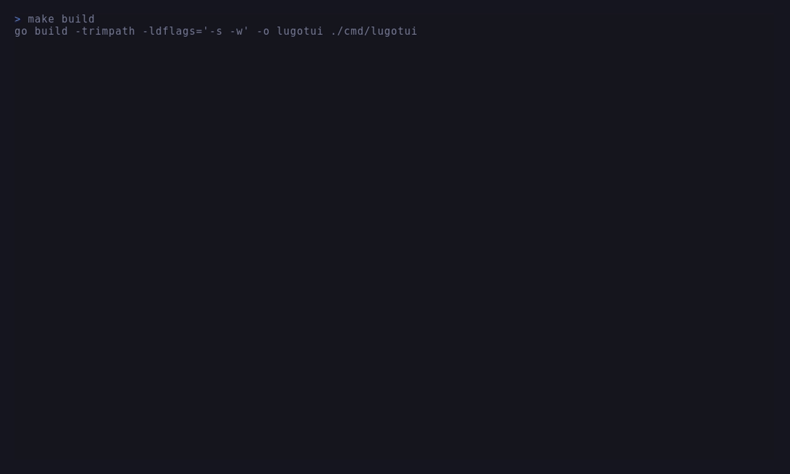

# LugoTUI

[](https://pkg.go.dev/github.com/VintlGvard/LugoTUI/tui)
[](LICENSE)
[](https://github.com/VintlGvard/LugoTUI/releases/latest)

**Declarative, Lua-driven Terminal UI Engine for Go with instant Live Hot-Reload and built-in AI Agent IPC.**

Stop recompiling your Go binary every time you tweak a margin or color. **LugoTUI** separates backend logic (Go) from declarative UI layouts (embedded Lua), with a Flexbox subset and file-backed hot-reload polling every 150ms. Builds with `CGO_ENABLED=0`.



---

## Why LugoTUI?

* 🔥 **Live Hot-Reload:** Edit `.lua` files; file-backed apps check for changes every 150ms and restore state after reload.
* 📦 **Zero CGO, Pure Go:** Powered by `tcell/v2`, `uniseg`, and `GopherLua`. Cross-compiles to a single static binary.
* 📐 **Flexbox Layout Engine:** Built-in `row`, `column`, `grow`, `shrink`, `gap`, `padding`, `z_index`, and absolute positioning.
* 🧩 **Rich Native Widgets:** Out-of-the-box `table`, `tree`, filterable `list`, `viewport`, `input`, `textarea`, `modal`, `filepicker`, and 12 `spinner` presets with Vim navigation and full mouse support.
* 🤖 **AI Agent-Ready (IPC Socket):** Inspect UI snapshots, trigger actions, and stream events externally via a JSON Lines Unix domain socket.
* 🛡️ **Transactional & Sandboxed:** Lua errors roll back cleanly without crashing the screen. Optional Linux `bubblewrap` sandbox isolates untrusted scripts.
* ⚡ **Fast & Lightweight:** Pure Flexbox layout in **45 µs**, idle RAM **~14 MB RSS**, static binary **5.3 MB**. See [benchmarks](docs/benchmarks.md).

---

## Quickstart

### 1. Go library

Requires **Go 1.26+**:

```sh
go get github.com/VintlGvard/LugoTUI/tui@latest
```

Define declarative UI in `app.lua`:
```lua
local ui = require('ui')

return {
  api_version = 1,
  view = function()
    return ui.column {
      padding = 1, gap = 1,
      ui.text { text = "Hello from LugoTUI!", height = 1 },
      ui.input { id = "name_in", bind = "name", placeholder = "Type your name...", height = 1 },
      ui.text { id = "greeting", text = "Waiting for input...", height = 1 },
      ui.button { id = "btn", text = "Uppercase & Save", on_click = "save", height = 1 }
    }
  end,
  actions = {
    save = function()
      local name = ui.get("name") or "Stranger"
      ui.set("name", string.upper(name))
      ui.patch("greeting", { text = "Saved: " .. string.upper(name) })
    end
  }
}
```

Run from `main.go`:
```go
package main

import (
	"log"

	"github.com/VintlGvard/LugoTUI/tui"
)

func main() {
	if err := tui.RunOptions(tui.Options{AppFile: "app.lua"}); err != nil {
		log.Fatal(err)
	}
}
```

```sh
go run .
```

*Quit with `Ctrl+Q`. Edits to `app.lua` hot-reload live; `F5` reloads manually. For async workers and Go events, see the [worker example](examples/worker/).*

### 2. Standalone CLI

Run Lua applications without writing Go:

```sh
# Via go install (Go 1.26+)
go install github.com/VintlGvard/LugoTUI/cmd/lugotui@latest

lugotui --app app.lua          # Run UI
lugotui --app app.lua --check  # Headless validation
```

Or download pre-built binaries from [Releases](https://github.com/VintlGvard/LugoTUI/releases/latest). See [CLI Installation Guide](docs/install.md) for PATH setup, checksums, and platform notes.

---

## Architecture: Go + Lua Model

LugoTUI follows a strict separation of concerns:

1. **Lua owns the View:** Declares widget trees and handles synchronous UI mutations (`ui.set`, `ui.patch`, `ui.replace`) in a single-threaded transactional runtime.
2. **Go owns Concurrency & I/O:** Runs databases, network calls, and background workers via `OnEvent` and `rt.StartTask(...)`, safely pushing results to Lua without data races.
3. **External Agents via IPC:** Automate and test interfaces over a Unix domain socket (`--socket ./app.sock`) via JSON Lines protocol.

---

## Documentation

* 🧩 **[Widgets & Lua Reference](docs/widgets.md)** — Layout rules, widget properties, and keybindings.
* 🤝 **[Architecture & Concurrency](docs/architecture.md)** — Goroutine ownership, task workers, and engine internals.
* 📊 **[Performance & Benchmarks](docs/benchmarks.md)** — Latency numbers, memory allocation stats, and reproduction steps.
* 🤖 **[Agent IPC Socket Protocol](docs/socket-protocol.md)** — JSON Lines API (`snapshot`, `apply`, `events`).
* 🔒 **[Linux Sandbox](docs/sandbox.md)** — Bubblewrap containerization for untrusted UI scripts.
* 💻 **[CLI Installation](docs/install.md)** — Binary archives, checksums, and environment configuration.
* 🧠 **[Agent Skill](skills/lugotui/SKILL.md)** — AI coding agent guide for building LugoTUI applications.

---

## Development

```sh
make run      # Run the demo app
make test     # Run test suite with race detector
make check    # Headless parse/layout/render validation
```

---

## License

Distributed under the **[Mozilla Public License 2.0 (MPL-2.0)](LICENSE)**.
